<div align="center">

# ☕ Yâren

**Her fincanda ortak bir hikâye.**

Geleneksel Türk kahvesini espresso ve modern demleme kültürüyle buluşturan hayali kahve markası için<br>
kaydırmaya bağlı canvas animasyonlarıyla hazırlanmış, mobil uyumlu tek sayfalık web sitesi.


**Canlı site:** _yayına alındığında eklenecek_

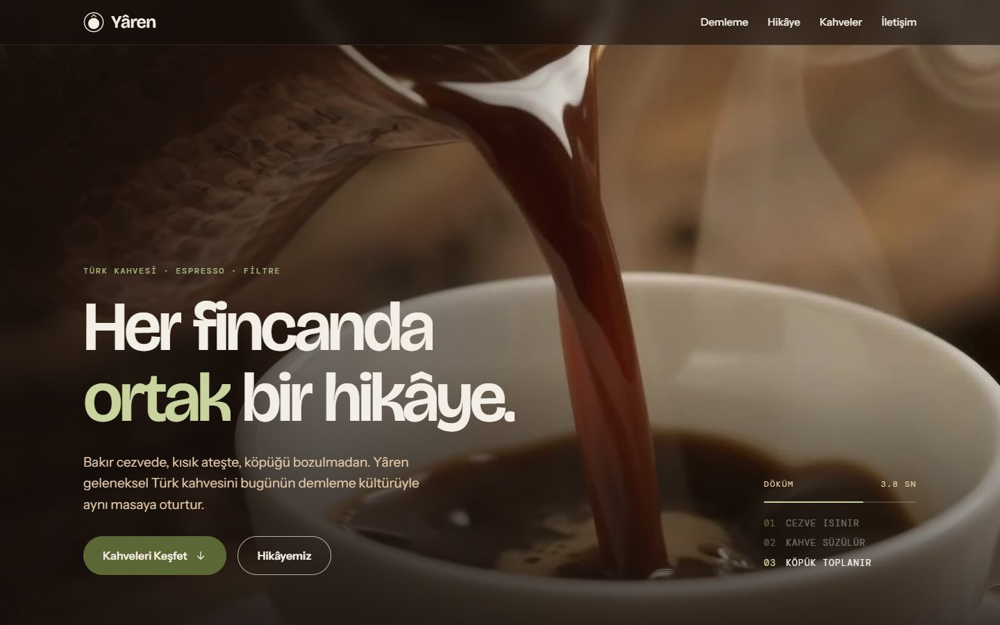

</div>

---

## İçindekiler

- [Kısaca](#kısaca)
- [Ekran görüntüleri](#ekran-görüntüleri)
- [Özellikler](#özellikler)
- [Case study gereksinimleri](#case-study-gereksinimleri)
- [Teknolojiler](#teknolojiler)
- [Hızlı başlangıç](#hızlı-başlangıç)
- [Komutlar](#komutlar)
- [Proje yapısı](#proje-yapısı)
- [Mimari](#mimari)
- [Kalite ve testler](#kalite-ve-testler)
- [Erişilebilirlik ve performans](#erişilebilirlik-ve-performans)
- [Tasarımdan bilinçli sapmalar](#tasarımdan-bilinçli-sapmalar)
- [Yayına alma](#yayına-alma)
- [Bilinen sınırlamalar](#bilinen-sınırlamalar)
- [Araçlar ve yapay zekâ kullanımı](#araçlar-ve-yapay-zekâ-kullanımı)

---

## Kısaca

Sayfa, kaydırmaya bağlı iki canvas kare dizisiyle açılıyor: cezveden fincana dökülen Türk kahvesi ve portafiltreden akan espresso, kullanıcı kaydırdıkça kare kare ilerliyor. "Hikâye" bölümünde 1.700 telve parçacığı kaydırmayla çekirdek, girdap, fincan ve "Yâren" yazısı biçimine giriyor; imleçle dokunulduğunda dağılıyor. Kahveler bölümünde şeker, shot ve boy seçimine göre fotoğraf ve fiyat değişiyor; "Bu kahve için yaz" seçimi iletişim formuna konu olarak taşıyor. Form boş alanları ve e-posta biçimini doğruluyor, geçerli gönderimde başarı mesajı gösteriyor (sunucu bağlantısı yok).

Tasarım ilk olarak saf HTML, CSS ve JS ile hazırlandı. Bu depo, aynı tasarımın **React 19, TypeScript ve Tailwind CSS 4** ile yeniden kurulmuş hâli. Orijinalle 45 metin öğesi üzerinden ölçülerek karşılaştırıldı; 1440 px ve 390 px'te konum, boyut ve stil farkı yok.

## Ekran görüntüleri

| Masaüstü                                                                                     |                                                                                         |
| -------------------------------------------------------------------------------------------- | --------------------------------------------------------------------------------------- |
| 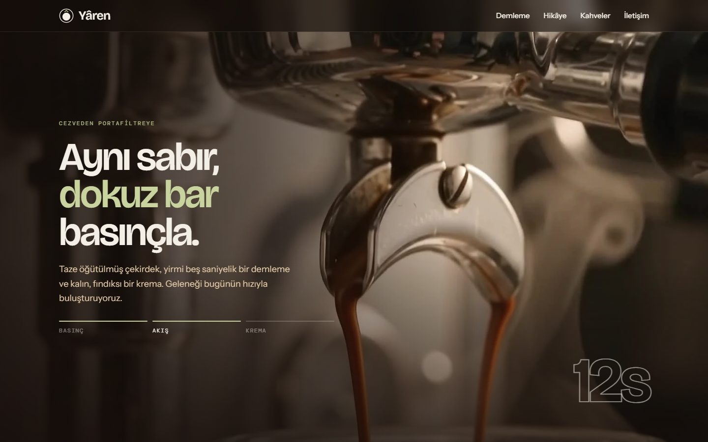 | 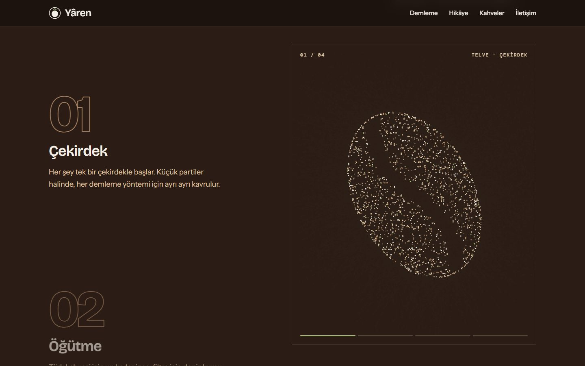    |
| **Demleme:** kaydırmaya bağlı espresso kare dizisi, faz çubukları ve sayaç                   | **Hikâye:** 1.700 parçacık, kaydırdıkça biçim değiştirir                                |
| 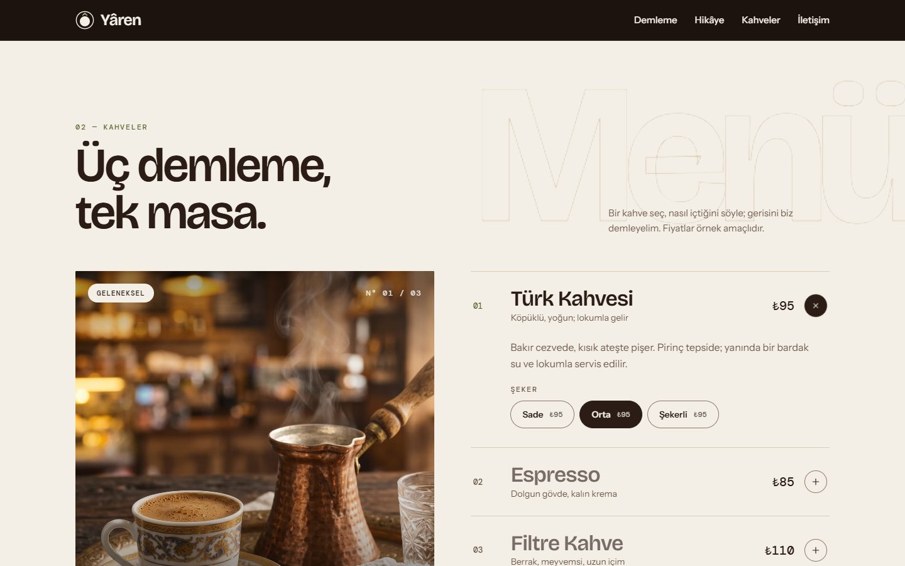              | 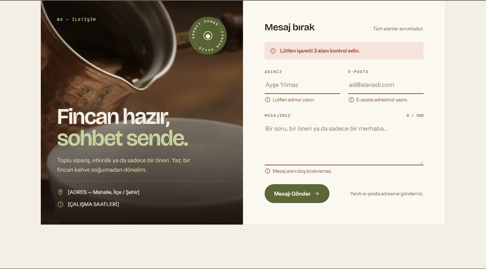 |
| **Kahveler:** seçim fotoğrafı, fiyatı ve form konusunu belirler                              | **Form doğrulama:** alan hataları, hata özeti, ilk hatalı alana odak                    |

| Mobil                                                                         |                                                                                     |                                                                                      | Yüklenirken                                                                                           |
| ----------------------------------------------------------------------------- | ----------------------------------------------------------------------------------- | ------------------------------------------------------------------------------------ | ----------------------------------------------------------------------------------------------------- |
| 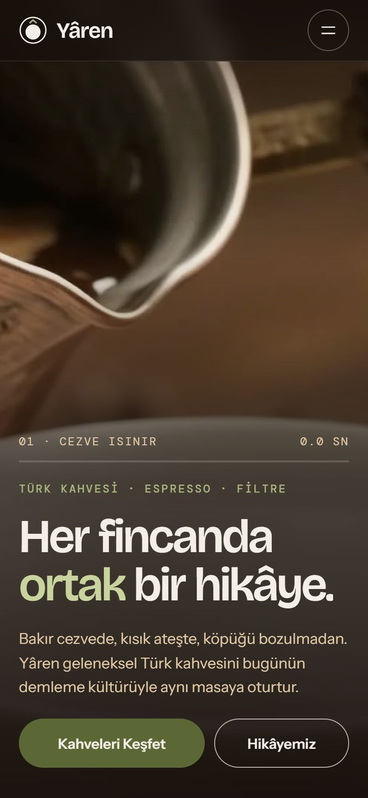 | 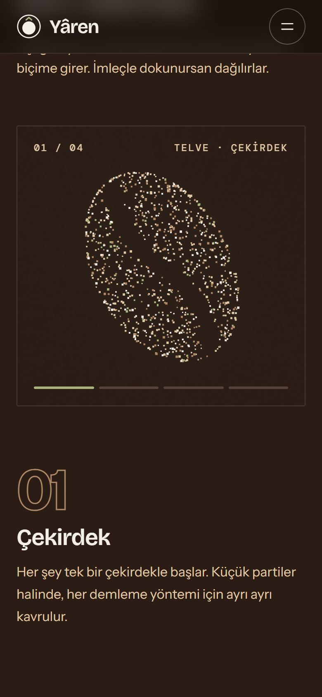 | 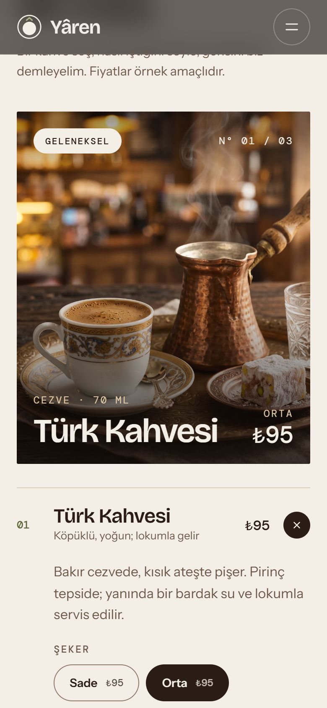 | 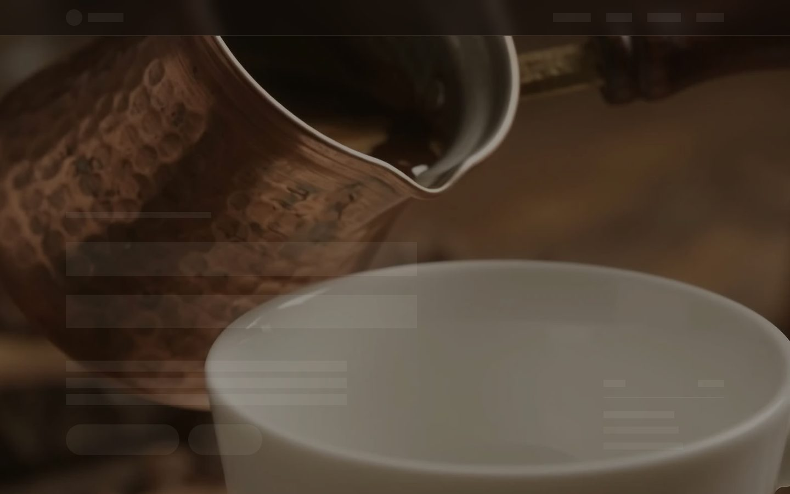 |
| Hero                                                                          | Hikâye                                                                              | Kahveler                                                                             | Kare hazır, metinler fontlar gelene kadar iskelet                                                     |

## Özellikler

- **Kaydırmaya bağlı kare dizileri:** İki dizi (60'ar kare, 1920×1080 WebP). Kare, `object-fit: cover` mantığıyla, odak noktası korunarak ve kaydırdıkça hafifçe yakınlaşarak canvas'a çizilir. Zaman çizelgesi, faz göstergesi ve sayaç kaydırmayla güncellenir.
- **Telve parçacıkları:** 1.700 parçacık (mobilde 1.000) yay fiziğiyle dört şekil arasında geçer. "Yâren" şekli, marka fontuyla ekran dışı bir canvas'a çizilip piksellerinden örneklenir. İmleç parçacıkları iter.
- **Seçilebilir kahve menüsü:** Açılır kapanır liste, seçeneğe göre fiyat, fotoğraf geçişi. Her kahvenin seçimi ayrı ayrı hatırlanır.
- **İletişim formu:** React Hook Form ve Zod ile doğrulama. İlk gönderime kadar sessiz, sonra canlı doğrulama; hata özeti, ilk hatalı alana odak, karakter sayacı, menüden gelen konu çipi, başarı ekranı.
- **Bölüm bölüm skeleton:** Her bölüm, ihtiyaç duyduğu görsel ve fontlar hazır olana kadar gerçek düzeninin iskeletini gösterir. İçerik gelince sayfa kaymaz.
- **Her ekranda tam oturma:** 16:10, 16:9, 21:9, 4:3, dikey tablet, uzun ve kısa telefon, yatay telefon. Kare dizisi sahneleri görünür alanı tam doldurur (`100dvh`), alçak ekranlarda metin küçülür.
- **Erişilebilirlik:** Semantik HTML, klavyeyle tam gezinme, görünür odak, ARIA durumları, WCAG AA kontrast, "hareketi azalt" desteği.

## Case study gereksinimleri

| #   | Gereksinim                                                                   | Karşılayan yer                                                                   | Doğrulama                    |
| --- | ---------------------------------------------------------------------------- | -------------------------------------------------------------------------------- | ---------------------------- |
| R1  | Marka adı ve slogan                                                          | Menü, hero, alt bilgi                                                            | e2e: `sayfa hatasız açılır…` |
| R2  | Ürün alanına kaydıran "Kahveleri Keşfet" butonu                              | Hero ve mobil menü → `#kahveler`                                                 | e2e, birim                   |
| R3  | Türk Kahvesi, Espresso, Filtre Kahve için görsel, kısa açıklama, örnek fiyat | [`src/data/menu.ts`](src/data/menu.ts), [`sections/coffee`](src/sections/coffee) | birim: `coffee.test.tsx`     |
| R4  | Ad, e-posta ve mesaj alanlı iletişim formu                                   | [`sections/contact`](src/sections/contact)                                       | birim, e2e                   |
| R5  | Boş alan ve e-posta biçimi kontrolü                                          | [`contactSchema.ts`](src/features/contact/contactSchema.ts)                      | 16 şema testi, e2e           |
| R6  | Geçerli gönderimde başarı mesajı (sunucusuz)                                 | [`ContactSuccess.tsx`](src/sections/contact/ContactSuccess.tsx)                  | birim, e2e                   |

## Teknolojiler

| Alan               | Seçim                                                                  | Neden                                                                                                   |
| ------------------ | ---------------------------------------------------------------------- | ------------------------------------------------------------------------------------------------------- |
| Arayüz             | **React 19.3** + **TypeScript 7.0**                                    | Bileşen yapısı, tipli veri, React 19'un `useEffectEvent` ve `inert` desteği                             |
| Derleme            | **Vite 8.3** (Rolldown)                                                | Hızlı geliştirme sunucusu, içerik özetli (hash'li) varlıklar                                            |
| Stil               | **Tailwind CSS 4.3** (`@tailwindcss/vite`)                             | CSS tabanlı `@theme`: tasarım tokenları tek yerde, Türkçe adlarıyla (`bg-kaymak`, `text-telve`)         |
| Hareket            | **Motion 14** (`LazyMotion` + `m`)                                     | Menü, akordeon ve form ↔ başarı geçişleri; animasyon motoru ayrı parça olarak sonradan yüklenir         |
| Form               | **React Hook Form 7** + **Zod 4** (`zod/mini`) + `@hookform/resolvers` | Doğrulama şeması tek yerde ve test edilebilir; `zod/mini` klasik API'nin yaklaşık dörtte biri boyutunda |
| Sınıf yardımcıları | `clsx` + `tailwind-merge`                                              | `cn()`; özel yardımcı sınıflar `extendTailwindMerge` ile tanıtıldı                                      |
| Fontlar            | Fontsource: Bricolage Grotesque, Instrument Sans, DM Mono              | Kendi sunucumuzdan; hero fontları önceden yüklenir                                                      |
| Canvas             | Canvas 2D API                                                          | Kare dizileri ve parçacıklar; harici kütüphane yok                                                      |
| Test               | **Vitest 5** + Testing Library, **Playwright 1.64** + axe-core         | Birim/bileşen testleri jsdom'da, uçtan uca testler gerçek Chrome'da                                     |
| Kalite             | oxlint, Prettier + `prettier-plugin-tailwindcss`                       | Lint ve tutarlı sınıf sırası                                                                            |

Bilinçli olarak **kullanılmayanlar**: router (tek sayfa), global durum kütüphanesi (paylaşılan tek durum küçük bir Context), GSAP (kare dizisi ~60 satırlık bir hook), Three.js (parçacıklar Canvas 2D ile yeterli), UI kiti (tasarım tamamen özel).

## Hızlı başlangıç

**Gereksinimler:** Node.js **22.12+** (Vitest 5 ve Vite 8 için), npm 10+. Uçtan uca testler için sistemde kurulu Google Chrome.

```bash
git clone <depo-adresi>
cd kahve-yaren
npm install
npm run dev          # http://localhost:5173
```

Üretim build'i:

```bash
npm run build        # tsc -b && vite build → dist/
npm run preview      # dist/ klasörünü yerelde sunar
```

## Komutlar

| Komut                             | Ne yapar                                                                       |
| --------------------------------- | ------------------------------------------------------------------------------ |
| `npm run dev`                     | Geliştirme sunucusu (anında yenileme)                                          |
| `npm run build`                   | Tip kontrolü ve üretim build'i (`dist/`)                                       |
| `npm run preview`                 | Build'i yerelde sunar                                                          |
| `npm test`                        | Birim ve bileşen testleri (Vitest, jsdom)                                      |
| `npm run test:watch`              | Testleri izleme modunda çalıştırır                                             |
| `npm run test:e2e`                | Uçtan uca testler (Playwright, sistem Chrome'u; build'i kendisi alır ve sunar) |
| `npm run lint`                    | oxlint                                                                         |
| `npm run format` / `format:check` | Prettier ile biçimlendirme / denetim                                           |

## Proje yapısı

```
kahve-yaren/
├── public/
│   ├── frames/                 tk_01–60.webp (Türk kahvesi), es_01–60.webp (espresso)
│   ├── favicon.svg
│   └── robots.txt
├── e2e/                        Playwright: duman, ekran oranları, skeleton, gezinme testleri
├── docs/screenshots/           README görselleri
└── src/
    ├── main.tsx                fontlar, stiller, StrictMode
    ├── App.tsx                 bölüm sırası, MotionProvider, ContactTopicProvider
    ├── styles/index.css        @theme tokenları · temel · yardımcılar · skeleton · hareket
    ├── assets/img/             ürün fotoğrafları
    ├── data/                   menü, gezinme, hikâye adımları, kare dizisi fazları
    ├── lib/                    cn(), matematik, canvas yerleşimi (coverRect), skeleton
    ├── hooks/                  useAnimationLoop, useFrameSequence, useAssetsReady, useMediaQuery…
    ├── features/
    │   ├── particles/          şekiller, parçacık sistemi, useParticles
    │   ├── coffee/             useCoffeeSelection, form konusu Context'i
    │   └── contact/            Zod şeması ve yardımcılar
    ├── components/
    │   ├── ui/                 Button, Chip, Eyebrow, Container, LinkLine
    │   ├── icons/              ikonlar, Logo
    │   ├── layout/             Navbar, MobileMenu, Marquee, Footer
    │   └── FrameSequence.tsx
    └── sections/               hero · brew · story · coffee · contact
```

Testler test ettikleri kodun yanında durur (`*.test.ts(x)`).

## Mimari

### Bileşen ağacı

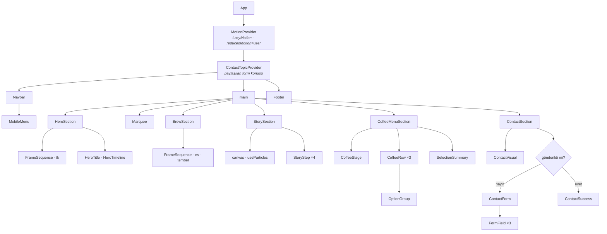

### Kahve seçiminden forma veri akışı

Bileşenler arasında paylaşılan tek durum, menüde seçilen kahvenin form konusu olması. Bunun için küçük bir Context yeterli; global durum kütüphanesi yok.

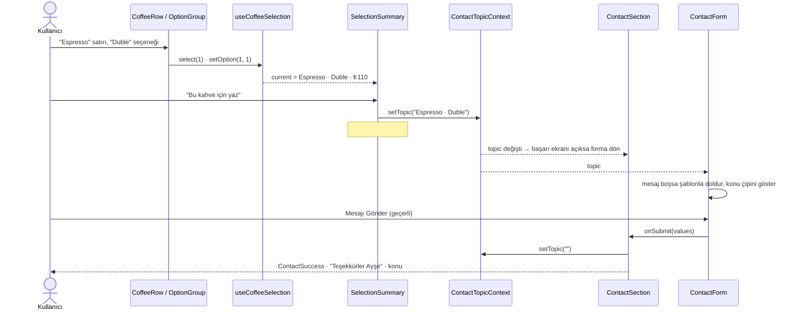

### Kaydırmaya bağlı kare dizisi

Bölüm, sahnesinin üstüne kaydırma mesafesi kadar uzundur (`100svh + 1700px`). Sahne `sticky` durur; bölüm kaydıkça ilerleme 0..1 hesaplanır. Sayfadaki bütün canvas'lar **tek bir** `requestAnimationFrame` döngüsünü paylaşır. Süre ve ilerleme çubuğu React state'i olmadan, ref üzerinden güncellenir; React yalnızca faz değiştiğinde yeniden çizim yapar.

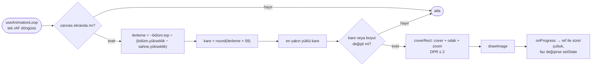

Espresso kareleri, bölüm ekrana bir ekran yüksekliği kadar yaklaşınca (`IntersectionObserver`) yüklenir.

### Telve parçacıkları

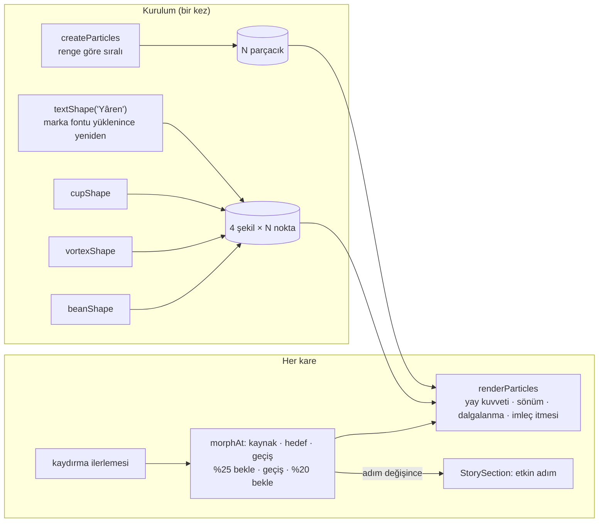

Şekil üretimi, kaydırma → geçiş hesabı ve fizik saf TypeScript fonksiyonlarıdır (`features/particles`). Hook yalnızca bunları bağlar; böylece hesaplar jsdom'da test edilebilir.

### Form doğrulama

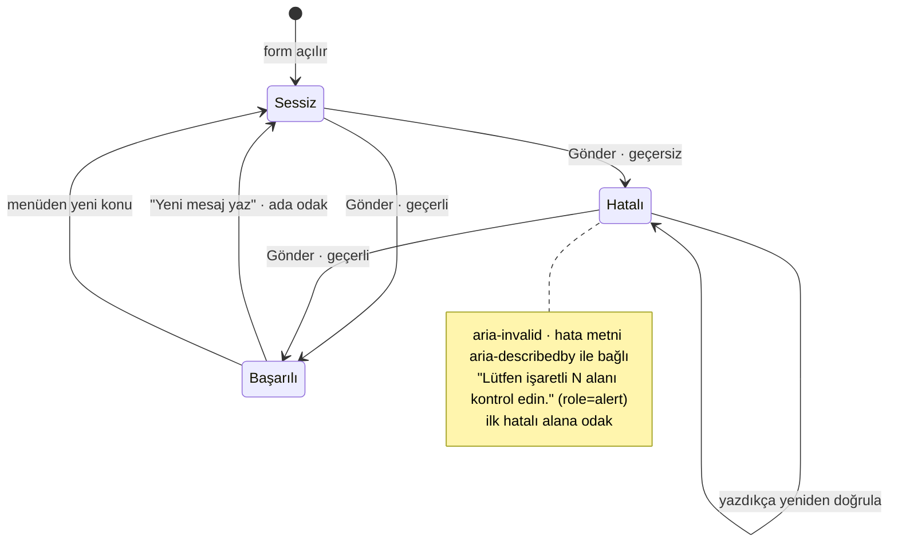

| Alan    | Kural                                              | Hata metni                                                                |
| ------- | -------------------------------------------------- | ------------------------------------------------------------------------- |
| Ad      | boşluklar atılınca boş olamaz                      | Lütfen adınızı yazın.                                                     |
| E-posta | boş olamaz; `ad@alan.uzantı` (uzantı en az 2 harf) | E-posta adresinizi yazın. / Geçerli bir e-posta girin, ör. ad@alanadi.com |
| Mesaj   | boş olamaz, en fazla 500 karakter                  | Mesaj alanı boş bırakılamaz.                                              |

### Skeleton yaşam döngüsü

Ayrı bir taslak düzen çizilmez; gerçek öğeler yerinde iskelete dönüşür. Bölüm köküne `data-loading` (iskelet tonu), öğelere `data-sk` işareti konur. Metin çizgileri gerçek satır kırılımlarını izler, bu yüzden içerik geldiğinde düzen değişmez.

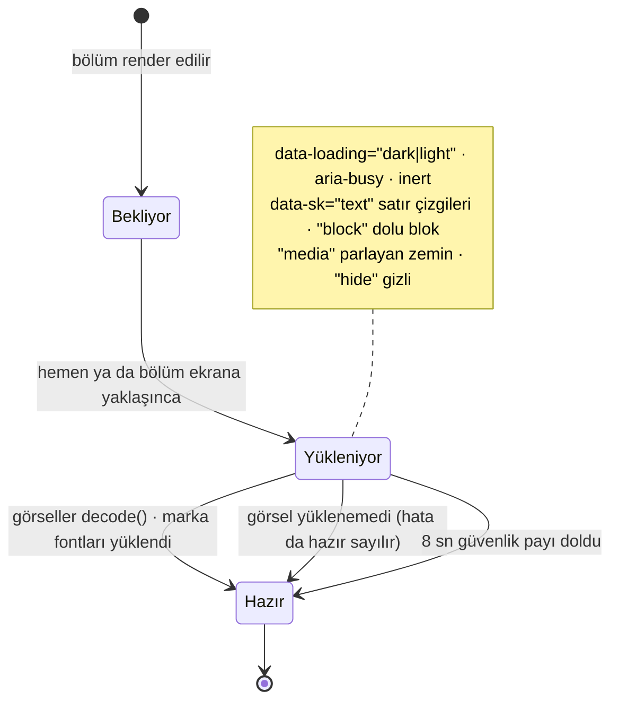

| Bölüm                          | Beklediği                               |
| ------------------------------ | --------------------------------------- |
| Hero                           | ilk kare ve fontlar                     |
| Demleme                        | ilk espresso karesi (bölüme yaklaşınca) |
| Hikâye, menü, şerit, alt bilgi | fontlar                                 |
| Kahveler                       | üç ürün fotoğrafı (bölüme yaklaşınca)   |
| İletişim                       | kapak görseli (bölüme yaklaşınca)       |

### Tasarım tokenları

Bütün renkler, fontlar, kırılımlar ve animasyonlar [`src/styles/index.css`](src/styles/index.css) içindeki `@theme` bloğunda tanımlıdır. Tailwind'in varsayılan paleti kapalıdır; yalnızca marka renkleri kullanılabilir.

| Token     | Renk      | Kullanım                   |
| --------- | --------- | -------------------------- |
| `kaymak`  | `#F4EFE6` | sayfa zemini (kırık beyaz) |
| `telve`   | `#2B1D16` | ana metin, koyu yüzey      |
| `gece`    | `#140D0A` | video zemini               |
| `zeytin`  | `#5B6835` | birincil eylem             |
| `krema`   | `#E2C9A6` | koyu zeminde gövde metni   |
| `kiremit` | `#A03D27` | hata                       |

Yazı boyutu sınıfları satır yüksekliği taşımaz, orijinal CSS gibi devralır. Kısa ekranlar için `short:` varyantı vardır (`@media (max-height: 520px)`).

## Kalite ve testler

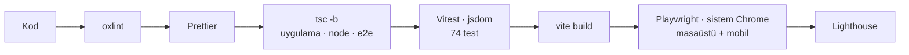

| Katman                        | Kapsam                                                                                                                                                                                                                                                                              |
| ----------------------------- | ----------------------------------------------------------------------------------------------------------------------------------------------------------------------------------------------------------------------------------------------------------------------------------- |
| **Birim** (Vitest)            | şema (boş alanlar, sadece boşluk, 9 e-posta örneği, 500 karakter sınırı), menü verisi, faz eşikleri, `coverRect`, parçacık şekilleri ve `morphAt`, `cn()`, skeleton hazır olma (hata, zaman aşımı, ertelenmiş yükleme)                                                              |
| **Bileşen** (Testing Library) | menü ve mobil menü, kahve seçimi ve fiyat, form akışının tamamı, konu çipi, başarı ekranı, bölüm içerikleri                                                                                                                                                                         |
| **Uçtan uca** (Playwright)    | case study maddeleri; 9 genişlikte yatay taşma; 10 ekran oranında sahne doluluğu; canvas'ların gerçekten çizmesi; kaydırmayla zaman çizelgesi; seçimden başarı mesajına akış; klavye odağı; hareketi azalt; skeleton'un görünüp kalkması ve düzen kaydırmaması; axe ile WCAG 2.1 AA |

Uçtan uca paket 12 senaryoyu masaüstü ve mobil projelerinde çalıştırır (24 test; 4'ü yalnızca ilgili projede anlamlı olduğu için diğerinde atlanır).

## Erişilebilirlik ve performans

**Erişilebilirlik**

- Semantik bölümler (`header`, `nav`, `main`, `section[aria-labelledby]`, `footer`); tıklanabilir `div` yok.
- Burger, akordeon ve seçenek butonlarında `aria-expanded`, `aria-controls`, `aria-pressed`; kahve sahnesinde `aria-live`.
- Form hataları `aria-invalid` ve `aria-describedby` ile bağlı; başarı mesajı `role="status"` ile duyurulur ve odağı alır.
- Kare dizileri `role="img"` ve açıklama taşır; dekoratif öğeler gizli.
- `prefers-reduced-motion`: CSS animasyonları ve parçacık fiziği durur, Motion geçişleri kapanır.
- Yüklenen bölüm `aria-busy` ve `inert`; boş içeriğe odak gitmez.

**Lighthouse 13.6** (yerel üretim build'i)

|          | Performans | Erişilebilirlik | En İyi Uygulamalar | SEO | LCP    | CLS |
| -------- | ---------- | --------------- | ------------------ | --- | ------ | --- |
| Mobil    | 79         | 100             | 100                | 100 | 4.9 sn | 0   |
| Masaüstü | 98         | 100             | 100                | 100 | 1.0 sn | 0   |

> Skeleton eklenmeden önce iki cihazda da Performans 100 ve mobil LCP 0.8 sn idi. Düşüşün tamamı hero'nun ilk kare ve fontlar gelene kadar iskelet göstermesinden geliyor. Hero'yu bu kuraldan muaf tutmak (metin hemen, yalnızca kare alanı iskelet) bu değeri geri getirir; bu karar henüz açık (bkz. [Tasarımdan bilinçli sapmalar](#tasarımdan-bilinçli-sapmalar)).

Performans için alınan önlemler: kareler WebP (~65 KB), ekran dışındaki canvas çizilmez, aynı kare tekrar çizilmez, DPR en fazla 2, espresso kareleri tembel yüklenir, hero karesi ve fontları önceden yüklenir, Motion'ın animasyon motoru ayrı parça (17 KB gzip).

## Tasarımdan bilinçli sapmalar

Görünüm orijinal tasarımla ölçülerek birebir tutuldu. Aşağıdakiler bilinçli farklar; gerekçeleri proje notlarında karar kaydı (ADR) olarak tutuluyor.

| Konu                       | Orijinal                          | Bu sürüm                     | Neden                                                                     |
| -------------------------- | --------------------------------- | ---------------------------- | ------------------------------------------------------------------------- |
| Kare dizisi sahnesi        | en fazla 1000 px (mobilde 844 px) | `100dvh`                     | 16:10 ve daha uzun ekranlarda sahnenin altında 80–600 px boşluk kalıyordu |
| Kısa ekranlar              | sabit ölçüler                     | `short:` varyantıyla küçülür | yatay telefonda metin sahneden taşıyordu                                  |
| Hikâye: etkin olmayan adım | `opacity: .3` (≈2.2:1)            | `opacity: .6` (≥4.5:1)       | WCAG AA kontrast                                                          |
| Kahve satırı numarası      | `gri-kahve` (3.6:1)               | `dem` (5.9:1)                | WCAG AA kontrast                                                          |
| Yükleme                    | içerik doğrudan                   | bölüm bölüm skeleton         | istenen özellik; mobil LCP bedeli yukarıda                                |

## Yayına alma

Statik bir sitedir; sunucu gerekmez. Build çıktısı `dist/` klasörüdür.

| Platform         | Ayar                                                                                                                                   |
| ---------------- | -------------------------------------------------------------------------------------------------------------------------------------- |
| **Vercel**       | Framework: Vite · Build: `npm run build` · Output: `dist`                                                                              |
| **Netlify**      | Build: `npm run build` · Publish: `dist`                                                                                               |
| **GitHub Pages** | `vite.config.ts` içinde `base: '/<depo-adı>/'`. Kare yolları `import.meta.env.BASE_URL` ile üretildiği için başka değişiklik gerekmez. |

## Bilinen sınırlamalar

- Form bir sunucuya gönderim yapmaz; geçerli gönderimde yalnızca başarı ekranı gösterilir (case study gereği).
- Adres ve çalışma saatleri `[ADRES]` ve `[ÇALIŞMA SAATLERİ]` olarak bırakıldı; fiyatlar örnek amaçlıdır.
- Erişilebilirlik axe, Lighthouse ve otomatik testlerle doğrulandı; gerçek bir ekran okuyucuyla (NVDA, VoiceOver) denenmedi.
- Sayfanın yaklaşık 4.2 MB'ı kare dizileridir. Mobilde hero için 60 yerine 30 kare yüklemek bu ağırlığı yaklaşık yarıya indirebilir.
- Fontlar yüklenmeden önce yedek font farklı satır kırılımı verebilir; bu, iskelet çizgilerinin font gelince yeniden şekillenmesine yol açar (içerik açılmadan önce, görünür içerikte kayma yok).

## Araçlar ve yapay zekâ kullanımı

Tasarım sistemi, bileşenler ve ekranlar önce saf HTML, CSS ve JS ile Claude ile birlikte tasarlanıp kodlandı. Ardından aynı tasarım, yine Claude Code ile React 19, TypeScript, Vite 8 ve Tailwind CSS 4 kullanılarak bu depoda yeniden kuruldu. Bu süreçte orijinal siteyle ölçümlü karşılaştırma, Playwright ve axe ile otomatik testler ve Lighthouse ölçümleri yapıldı. Video kareleri ve ürün fotoğrafları proje sahibi tarafından sağlandı.

---

<div align="center">

Yâren hayali bir markadır · Aday çalışması · © 2026

</div>
